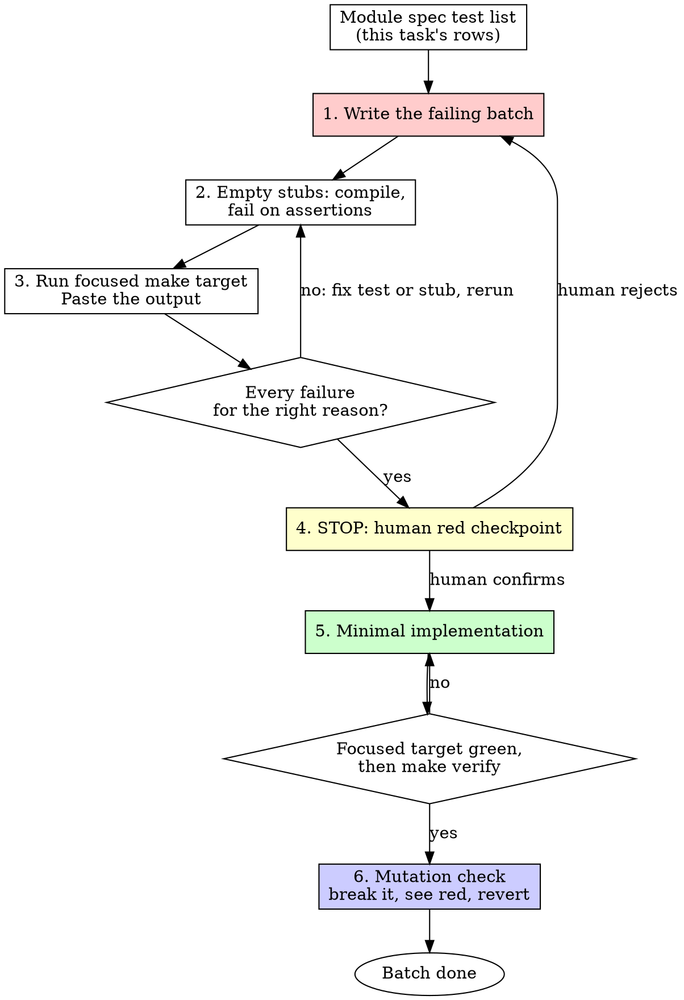

# Test-Driven Development (TDD)

## Overview

Write the failing tests first, as one batch. Make sure they fail for the right reason. Get the human's red checkpoint. Then write minimal code to pass.

**Core principle:** If you didn't watch the test fail, you don't know if it tests the right thing. In this repo a red test only counts once a human has checked *why* it is red.

**Violating the letter of the rules is violating the spirit of the rules.**

## When to Use

**Always:**
- New features
- Bug fixes
- Refactoring
- Behavior changes

**Exceptions (ask your human partner):**
- Throwaway prototypes
- Generated code
- Configuration files

Thinking "skip TDD just this once"? Stop. That's rationalization.

## The Iron Law

```
NO PRODUCTION CODE WITHOUT A FAILING TEST FIRST
```

Write code before the test? Delete it. Start over.

**No exceptions:**
- Don't keep it as "reference"
- Don't "adapt" it while writing tests
- Don't look at it
- Delete means delete

Implement fresh from tests. Period.

The only code allowed before the red checkpoint is a stub with no behaviour (step 2 below).

## The Batch Protocol

Tests are written per task, in one batch, from the rows of the module spec test list (`docs/modules/<module>.md`). They are not written one at a time inside the agent loop.



**Why a batch and a human checkpoint:** agent-inner-loop red/green per test showed no quality gain at 3-8.5x the tokens, while up-front design plus test-first helped, and a red test proves something only when someone checks why it is red ([Böckeler, martinfowler.com](https://martinfowler.com/articles/exploring-gen-ai/tdd-in-the-agent-loop.html)).

### 1. Write the Failing Batch

Write every test for this task's spec rows before any implementation. Pick the layer from the spec:
- `db`: `DO $$ ... ASSERT` blocks in `api/db/tests/*.sql`, run by `make db-test`.
- `api`: table-driven Go tests in `api/internal/server/<module>_test.go`, run by `make test-api`.
- `web-load`, `web-component`, `web-ssr`: tests in `web/src/`, run by `make test-web FILE=...`.

**One behavior per test, clear name, real code (no mocks unless unavoidable).**

<Good>
```typescript
test('retries failed operations 3 times', async () => {
  let attempts = 0;
  const operation = () => {
    attempts++;
    if (attempts < 3) throw new Error('fail');
    return 'success';
  };

  const result = await retryOperation(operation);

  expect(result).toBe('success');
  expect(attempts).toBe(3);
});
```
Clear name, tests real behavior, one thing
</Good>

<Bad>
```typescript
test('retry works', async () => {
  const mock = vi.fn()
    .mockRejectedValueOnce(new Error())
    .mockRejectedValueOnce(new Error())
    .mockResolvedValueOnce('success');
  await retryOperation(mock);
  expect(mock).toHaveBeenCalledTimes(3);
});
```
Vague name, tests mock not code
</Bad>

**Requirements:**
- One behavior
- Clear name
- Real code (no mocks unless unavoidable)

Expected values are literals, derived by hand (see [writing-good-tests.md](writing-good-tests.md)).

### 2. Create Stubs, Not Implementations

Create only what the tests need to compile and run:
- Go: functions with the right signature that return `nil, ErrNotImplemented` (the handler answers 501).
- Web: an empty `+page.svelte` and a `+page.ts` that returns `{}`.
- DB: no migration yet. A missing table is a valid red for `db` tests; the migration is part of step 5.

A stub that does real work is implementation. It belongs after the checkpoint, and it makes the red meaningless.

### 3. Run the Focused Target and Paste the Output

**MANDATORY. Never skip.**

```bash
make test-api RUN=TestDemo PKG=./internal/server/...
make db-test
make test-web FILE=src/routes/demo
```

Confirm:
- Every test in the batch fails (not errors, not skipped)
- Each failure message is for the expected reason
- The failing output is pasted into the PR body under "Red output"

**Test passes?** You're testing existing behavior. Fix the test or drop it.

**Test errors** (compile error, `cannot find module`, typo, panic in setup)? Fix the test or stub and re-run until it fails on an assertion.

### 4. Stop at the Human Red Checkpoint

**STOP.** Do not write implementation code. The human reads each failure and confirms it is red for the right reason, for example:
- `status = 501, want 200` (handler not implemented yet)
- `relation "demo_items" does not exist` (migration not written yet)

Wrong reasons that the human rejects: `undefined: NewThing`, `cannot find module`, nil-pointer panic in the test setup, a failure on a field the spec never mentions. The agent does not confirm its own checkpoint. A rejected checkpoint returns to step 1.

### 5. Implement to Green

Only after the checkpoint is confirmed: write the simplest code that passes the batch. Then:
- Run the focused target until it is green.
- Run `make verify`; add `make verify-full` if SQL or migrations changed. `make verify` runs Go tests with `-short`, so Postgres-backed tests skip there. They must also pass under `make test-api` or `make verify-full`.
- Output pristine (no errors, warnings).

<Good>
```typescript
async function retryOperation<T>(fn: () => Promise<T>): Promise<T> {
  for (let i = 0; i < 3; i++) {
    try {
      return await fn();
    } catch (e) {
      if (i === 2) throw e;
    }
  }
  throw new Error('unreachable');
}
```
Just enough to pass
</Good>

<Bad>
```typescript
async function retryOperation<T>(
  fn: () => Promise<T>,
  options?: {
    maxRetries?: number;
    backoff?: 'linear' | 'exponential';
    onRetry?: (attempt: number) => void;
  }
): Promise<T> {
  // YAGNI
}
```
Over-engineered
</Bad>

Don't add features, refactor other code, or "improve" beyond the batch.

**Test fails?** Fix code, not test. Never weaken, skip or delete a test to make it pass; say so in the report instead.

**Other tests fail?** Fix now.

**"Other tests" means the project's suite, not just your file.** Run `make verify` even when your task named only one test file. Any failure that run shows, including one you didn't cause, goes in your report by name.

### 6. Mutation Check

Before the batch is done, break the implementation on purpose, one mutation at a time: wrong constant or argument, wrong branch, missing side effect, empty return, missing validation for zero, empty, nil, unauthorized or malformed input. After each mutation run the focused target; at least one test must go red. Revert and run green again. A mutation nothing catches means the behavior is unprotected or the test is tautological. The full list is in [writing-good-tests.md](writing-good-tests.md).

### Refactor

After green only:
- Remove duplication
- Improve names
- Extract helpers

Keep the focused target and `make verify` green. Don't add behavior.

### Next Batch

Repeat the protocol for the next task's rows.

## Good Tests

| Quality | Good | Bad |
|---------|------|-----|
| **Minimal** | One thing. "and" in name? Split it. | `test('validates email and domain and whitespace')` |
| **Clear** | Name describes behavior | `test('test1')` |
| **Shows intent** | Demonstrates desired API | Obscures what code should do |

When writing or changing any test, read [writing-good-tests.md](writing-good-tests.md) for the rules that keep tests honest:
- Name the production change that would make the test fail — before writing it
- Assert on real behavior, never on mock behavior
- Keep test-only code in test utilities, out of production classes
- Understand a dependency's side effects before mocking it

## Common Rationalizations

| Excuse | Reality |
|--------|---------|
| "Too simple to test" | Simple code breaks. Test takes 30 seconds. |
| "I'll test after" | Tests written after pass immediately — which proves nothing. They may test the wrong thing, test the implementation instead of the behavior, or miss the edge case you forgot. You never watched it fail, so you never proved it can catch the bug. Test-first forces that failure. |
| "Tests after achieve same goals (spirit not ritual)" | Tests-after answer "what does this do?"; tests-first answer "what should this do?" Tests written after are biased by the code you already wrote — you verify the cases you remembered, not the ones you'd have discovered. Coverage without proof the tests work. |
| "Already manually tested" | Manual testing is ad-hoc: no record of what you covered, no way to re-run it when the code changes, easy to forget cases under pressure. "Worked when I tried it" ≠ comprehensive. Automated tests run the same way every time. |
| "Deleting X hours is wasteful" | Sunk cost fallacy — that time is already spent either way. The real choice: rewrite with TDD (high confidence) vs. keep it and bolt tests on after (low confidence, likely bugs). Keeping code you can't trust is the waste. |
| "Keep as reference, write tests first" | You'll adapt it. That's testing after. Delete means delete. |
| "Need to explore first" | Fine. Throw away exploration, start with TDD. |
| "Test hard = design unclear" | Listen to test. Hard to test = hard to use. |
| "TDD will slow me down" | TDD IS the pragmatic path: catches bugs before commit, prevents regressions, lets you refactor without fear. "Pragmatic" shortcuts mean debugging in production — slower, not faster. |
| "Manual test faster" | Manual doesn't prove edge cases. You'll re-test every change. |
| "Existing code has no tests" | You're improving it. Add tests for existing code. |
| "One test at a time is faster" | The per-test loop inside the agent showed no quality gain at 3-8.5x the tokens. Write the batch, then checkpoint. |
| "The red checkpoint is a formality" | It is the only check that a red is for the right reason. A test that fails on a missing import proves nothing. |
| "A stub that does a little work is fine" | A stub with behavior is implementation written before the checkpoint. Stubs return `ErrNotImplemented` or nothing. |
| "Tests pass, so the mutation check is redundant" | Passing tests never proved they can fail. Break the code and watch them go red. |

## Red Flags - STOP and Start Over

- Code before test
- Test after implementation
- Test passes immediately
- Can't explain why test failed
- Red output is a compile error, import error or typo (wrong reason)
- Implementing before the human red checkpoint is confirmed
- Stubs that contain behavior
- Tests added "later"
- Writing one test, implementing it, then the next (the per-test loop)
- Rationalizing "just this once"
- "I already manually tested it"
- "Tests after achieve the same purpose"
- "It's about spirit not ritual"
- "Keep as reference" or "adapt existing code"
- "Already spent X hours, deleting is wasteful"
- "TDD is dogmatic, I'm being pragmatic"
- "This is different because..."

**All of these mean: Stop. Delete code written before its test. Return to step 1 of the batch protocol.**

## Example: Bug Fix

**Bug:** Empty email accepted

**RED** (step 1 and 3 of the batch protocol)
```typescript
test('rejects empty email', async () => {
  const result = await submitForm({ email: '' });
  expect(result.error).toBe('Email required');
});
```

**Verify RED**
```bash
$ make test-web FILE=src/routes/submit/page.spec.ts
FAIL: expected 'Email required', got undefined
```

The failing output goes in the PR's red output, and the human checkpoint applies before the fix.

**GREEN** (step 5)
```typescript
function submitForm(data: FormData) {
  if (!data.email?.trim()) {
    return { error: 'Email required' };
  }
  // ...
}
```

**Verify GREEN**
```bash
$ make test-web FILE=src/routes/submit/page.spec.ts
PASS
$ make verify
... (tail pasted)
```

**REFACTOR**
Extract validation for multiple fields if needed.

## Verification Checklist

Before marking work complete:

- [ ] Every new function, method and endpoint in the task has a test from the spec test list
- [ ] The failing batch was written before implementation; only stubs existed before the checkpoint
- [ ] Red output pasted; each failure is for the expected reason
- [ ] Human red checkpoint confirmed before implementation
- [ ] Minimal code written to pass the batch; focused target green
- [ ] `make verify` exits 0 (and `make verify-full` if SQL or migrations changed); tail pasted
- [ ] Mutation check done; each realistic mutation was caught by a test
- [ ] No test weakened, skipped or deleted
- [ ] Tests use real code (mocks only if unavoidable)
- [ ] Edge cases and errors covered

Can't check all boxes? You skipped TDD. Start over from step 1.

## When Stuck

| Problem | Solution |
|---------|----------|
| Don't know how to test | Write wished-for API. Write assertion first. Ask your human partner. |
| Test too complicated | Design too complicated. Simplify interface. |
| Must mock everything | Code too coupled. Use dependency injection. |
| Test setup huge | Extract helpers. Still complex? Simplify design. |
| Spec test list has no row for the behavior | Stop and ask for a spec change (module-contract). Don't invent a test silently. |

## Debugging Integration

Bug found? Write the failing test reproducing it, run the batch protocol (checkpoint included), then fix. The test proves the fix and prevents regression. For finding the cause, see `systematic-debugging`.

Never fix bugs without a test.

## Final Rule

```
Production code → test exists and failed first, and a human confirmed why
Otherwise → not TDD
```

No exceptions without your human partner's permission.
