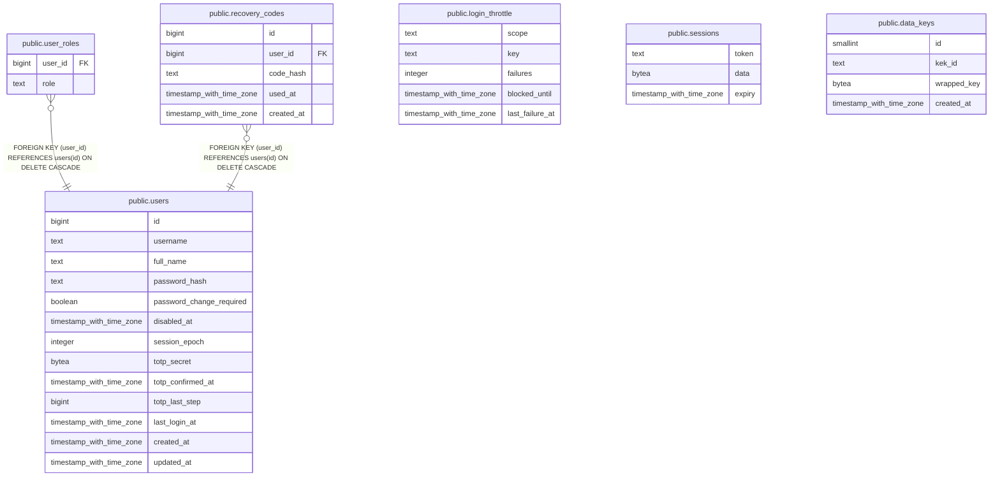

# bappelitbangda

## Tables

| Name | Columns | Comment | Type |
| ---- | ------- | ------- | ---- |
| [public.users](public.users.md) | 13 | Admin panel accounts. Never deleted; deactivated through disabled_at. totp_secret is ciphertext (keyring, version byte 0x01). | BASE TABLE |
| [public.user_roles](public.user_roles.md) | 2 | Roles of a user (fixed set, see internal/authz). The primary key also serves as the foreign key index. | BASE TABLE |
| [public.recovery_codes](public.recovery_codes.md) | 5 | One-time TOTP recovery codes, stored as argon2id hashes. Regeneration replaces the whole set. | BASE TABLE |
| [public.login_throttle](public.login_throttle.md) | 5 | Failed-login counters per account (lowercased username) and per client IP, with the block deadline. | BASE TABLE |
| [public.sessions](public.sessions.md) | 3 | Server-side sessions (alexedwards/scs pgxstore schema). The token is the cookie value. | BASE TABLE |
| [public.data_keys](public.data_keys.md) | 4 | Envelope encryption data keys (DEK), wrapped with a key encryption key from the KEK file. The active DEK is the one with the highest id. | BASE TABLE |

## Stored procedures and functions

| Name | ReturnType | Arguments | Type |
| ---- | ------- | ------- | ---- |
| public.set_limit | float4 | real | FUNCTION |
| public.show_limit | float4 |  | FUNCTION |
| public.show_trgm | _text | text | FUNCTION |
| public.similarity | float4 | text, text | FUNCTION |
| public.similarity_op | bool | text, text | FUNCTION |
| public.word_similarity | float4 | text, text | FUNCTION |
| public.word_similarity_op | bool | text, text | FUNCTION |
| public.word_similarity_commutator_op | bool | text, text | FUNCTION |
| public.similarity_dist | float4 | text, text | FUNCTION |
| public.word_similarity_dist_op | float4 | text, text | FUNCTION |
| public.word_similarity_dist_commutator_op | float4 | text, text | FUNCTION |
| public.gtrgm_in | gtrgm | cstring | FUNCTION |
| public.gtrgm_out | cstring | gtrgm | FUNCTION |
| public.gtrgm_consistent | bool | internal, text, smallint, oid, internal | FUNCTION |
| public.gtrgm_distance | float8 | internal, text, smallint, oid, internal | FUNCTION |
| public.gtrgm_compress | internal | internal | FUNCTION |
| public.gtrgm_decompress | internal | internal | FUNCTION |
| public.gtrgm_penalty | internal | internal, internal, internal | FUNCTION |
| public.gtrgm_picksplit | internal | internal, internal | FUNCTION |
| public.gtrgm_union | gtrgm | internal, internal | FUNCTION |
| public.gtrgm_same | internal | gtrgm, gtrgm, internal | FUNCTION |
| public.gin_extract_value_trgm | internal | text, internal | FUNCTION |
| public.gin_extract_query_trgm | internal | text, internal, smallint, internal, internal, internal, internal | FUNCTION |
| public.gin_trgm_consistent | bool | internal, smallint, text, integer, internal, internal, internal, internal | FUNCTION |
| public.gin_trgm_triconsistent | char | internal, smallint, text, integer, internal, internal, internal | FUNCTION |
| public.strict_word_similarity | float4 | text, text | FUNCTION |
| public.strict_word_similarity_op | bool | text, text | FUNCTION |
| public.strict_word_similarity_commutator_op | bool | text, text | FUNCTION |
| public.strict_word_similarity_dist_op | float4 | text, text | FUNCTION |
| public.strict_word_similarity_dist_commutator_op | float4 | text, text | FUNCTION |
| public.gtrgm_options | void | internal | FUNCTION |
| public.unaccent | text | regdictionary, text | FUNCTION |
| public.unaccent | text | text | FUNCTION |
| public.unaccent_init | internal | internal | FUNCTION |
| public.unaccent_lexize | internal | internal, internal, internal, internal | FUNCTION |

## Relations

---

> Generated by [tbls](https://github.com/k1LoW/tbls)
