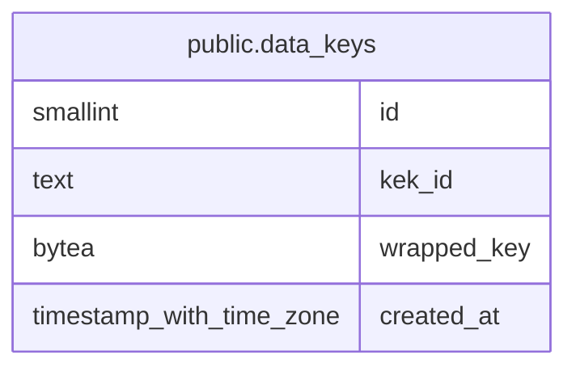

# public.data_keys

## Description

Envelope encryption data keys (DEK), wrapped with a key encryption key from the KEK file. The active DEK is the one with the highest id.

## Columns

| Name | Type | Default | Nullable | Children | Parents | Comment |
| ---- | ---- | ------- | -------- | -------- | ------- | ------- |
| id | smallint |  | false |  |  |  |
| kek_id | text |  | false |  |  |  |
| wrapped_key | bytea |  | false |  |  |  |
| created_at | timestamp with time zone | now() | false |  |  |  |

## Constraints

| Name | Type | Definition |
| ---- | ---- | ---------- |
| data_keys_created_at_not_null | n | NOT NULL created_at |
| data_keys_id_not_null | n | NOT NULL id |
| data_keys_kek_id_not_null | n | NOT NULL kek_id |
| data_keys_wrapped_key_not_null | n | NOT NULL wrapped_key |
| data_keys_pkey | PRIMARY KEY | PRIMARY KEY (id) |

## Indexes

| Name | Definition |
| ---- | ---------- |
| data_keys_pkey | CREATE UNIQUE INDEX data_keys_pkey ON public.data_keys USING btree (id) |

## Relations

---

> Generated by [tbls](https://github.com/k1LoW/tbls)
