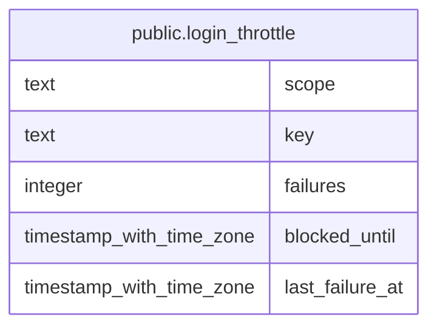

# public.login_throttle

## Description

Failed-login counters per account (lowercased username) and per client IP, with the block deadline.

## Columns

| Name | Type | Default | Nullable | Children | Parents | Comment |
| ---- | ---- | ------- | -------- | -------- | ------- | ------- |
| scope | text |  | false |  |  |  |
| key | text |  | false |  |  |  |
| failures | integer | 0 | false |  |  |  |
| blocked_until | timestamp with time zone |  | true |  |  |  |
| last_failure_at | timestamp with time zone |  | false |  |  |  |

## Constraints

| Name | Type | Definition |
| ---- | ---- | ---------- |
| login_throttle_failures_not_null | n | NOT NULL failures |
| login_throttle_key_not_null | n | NOT NULL key |
| login_throttle_last_failure_at_not_null | n | NOT NULL last_failure_at |
| login_throttle_scope_known | CHECK | CHECK ((scope = ANY (ARRAY['account'::text, 'ip'::text]))) |
| login_throttle_scope_not_null | n | NOT NULL scope |
| login_throttle_pkey | PRIMARY KEY | PRIMARY KEY (scope, key) |

## Indexes

| Name | Definition |
| ---- | ---------- |
| login_throttle_pkey | CREATE UNIQUE INDEX login_throttle_pkey ON public.login_throttle USING btree (scope, key) |

## Relations

---

> Generated by [tbls](https://github.com/k1LoW/tbls)
