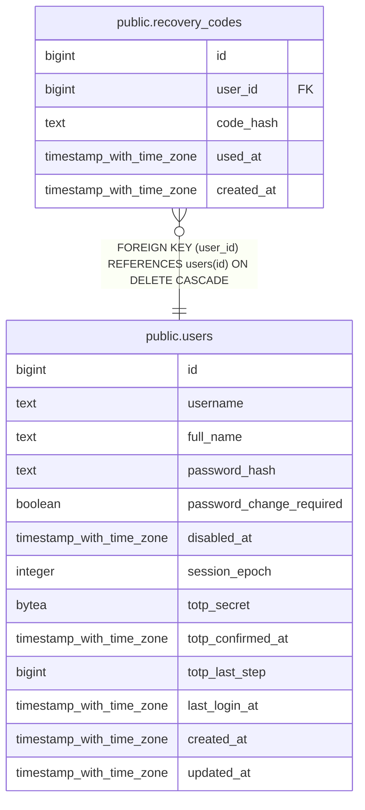

# public.recovery_codes

## Description

One-time TOTP recovery codes, stored as argon2id hashes. Regeneration replaces the whole set.

## Columns

| Name | Type | Default | Nullable | Children | Parents | Comment |
| ---- | ---- | ------- | -------- | -------- | ------- | ------- |
| id | bigint |  | false |  |  |  |
| user_id | bigint |  | false |  | [public.users](public.users.md) |  |
| code_hash | text |  | false |  |  |  |
| used_at | timestamp with time zone |  | true |  |  |  |
| created_at | timestamp with time zone | now() | false |  |  |  |

## Constraints

| Name | Type | Definition |
| ---- | ---- | ---------- |
| recovery_codes_code_hash_not_null | n | NOT NULL code_hash |
| recovery_codes_created_at_not_null | n | NOT NULL created_at |
| recovery_codes_id_not_null | n | NOT NULL id |
| recovery_codes_user_id_not_null | n | NOT NULL user_id |
| recovery_codes_user_id_fkey | FOREIGN KEY | FOREIGN KEY (user_id) REFERENCES users(id) ON DELETE CASCADE |
| recovery_codes_pkey | PRIMARY KEY | PRIMARY KEY (id) |

## Indexes

| Name | Definition |
| ---- | ---------- |
| recovery_codes_pkey | CREATE UNIQUE INDEX recovery_codes_pkey ON public.recovery_codes USING btree (id) |
| recovery_codes_user_id_idx | CREATE INDEX recovery_codes_user_id_idx ON public.recovery_codes USING btree (user_id) |

## Relations

---

> Generated by [tbls](https://github.com/k1LoW/tbls)
