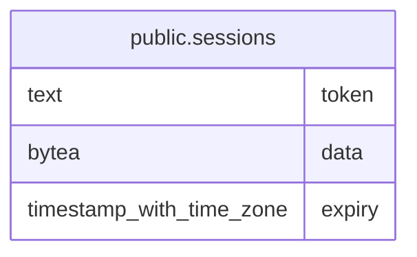

# public.sessions

## Description

Server-side sessions (alexedwards/scs pgxstore schema). The token is the cookie value.

## Columns

| Name | Type | Default | Nullable | Children | Parents | Comment |
| ---- | ---- | ------- | -------- | -------- | ------- | ------- |
| token | text |  | false |  |  |  |
| data | bytea |  | false |  |  |  |
| expiry | timestamp with time zone |  | false |  |  |  |

## Constraints

| Name | Type | Definition |
| ---- | ---- | ---------- |
| sessions_data_not_null | n | NOT NULL data |
| sessions_expiry_not_null | n | NOT NULL expiry |
| sessions_token_not_null | n | NOT NULL token |
| sessions_pkey | PRIMARY KEY | PRIMARY KEY (token) |

## Indexes

| Name | Definition |
| ---- | ---------- |
| sessions_pkey | CREATE UNIQUE INDEX sessions_pkey ON public.sessions USING btree (token) |
| sessions_expiry_idx | CREATE INDEX sessions_expiry_idx ON public.sessions USING btree (expiry) |

## Relations

---

> Generated by [tbls](https://github.com/k1LoW/tbls)
