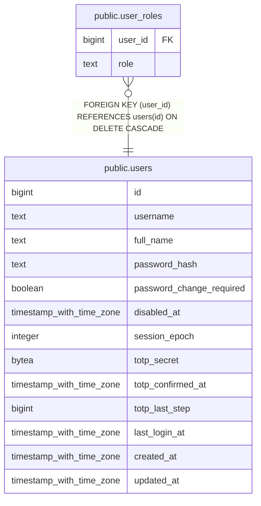

# public.user_roles

## Description

Roles of a user (fixed set, see internal/authz). The primary key also serves as the foreign key index.

## Columns

| Name | Type | Default | Nullable | Children | Parents | Comment |
| ---- | ---- | ------- | -------- | -------- | ------- | ------- |
| user_id | bigint |  | false |  | [public.users](public.users.md) |  |
| role | text |  | false |  |  |  |

## Constraints

| Name | Type | Definition |
| ---- | ---- | ---------- |
| user_roles_role_known | CHECK | CHECK ((role = ANY (ARRAY['super_admin'::text, 'humas_editor'::text, 'document_operator'::text, 'ppid_officer'::text, 'leadership'::text]))) |
| user_roles_role_not_null | n | NOT NULL role |
| user_roles_user_id_not_null | n | NOT NULL user_id |
| user_roles_user_id_fkey | FOREIGN KEY | FOREIGN KEY (user_id) REFERENCES users(id) ON DELETE CASCADE |
| user_roles_pkey | PRIMARY KEY | PRIMARY KEY (user_id, role) |

## Indexes

| Name | Definition |
| ---- | ---------- |
| user_roles_pkey | CREATE UNIQUE INDEX user_roles_pkey ON public.user_roles USING btree (user_id, role) |

## Relations

---

> Generated by [tbls](https://github.com/k1LoW/tbls)
