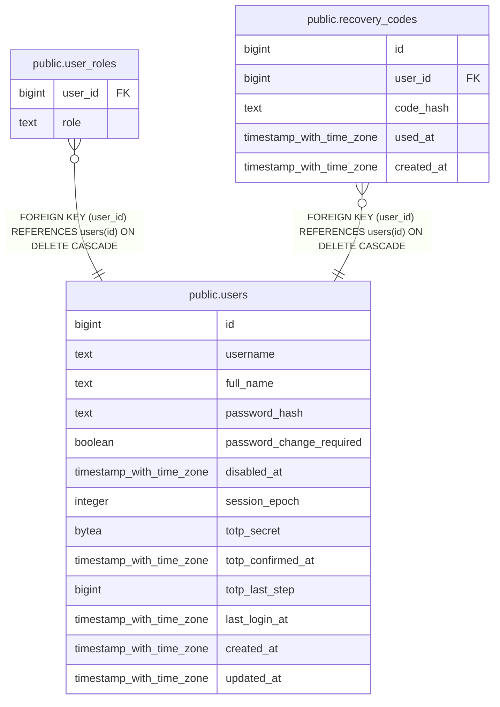

# public.users

## Description

Admin panel accounts. Never deleted; deactivated through disabled_at. totp_secret is ciphertext (keyring, version byte 0x01).

## Columns

| Name | Type | Default | Nullable | Children | Parents | Comment |
| ---- | ---- | ------- | -------- | -------- | ------- | ------- |
| id | bigint |  | false | [public.user_roles](public.user_roles.md) [public.recovery_codes](public.recovery_codes.md) |  |  |
| username | text |  | false |  |  |  |
| full_name | text |  | false |  |  |  |
| password_hash | text |  | false |  |  |  |
| password_change_required | boolean | true | false |  |  |  |
| disabled_at | timestamp with time zone |  | true |  |  |  |
| session_epoch | integer | 0 | false |  |  |  |
| totp_secret | bytea |  | true |  |  |  |
| totp_confirmed_at | timestamp with time zone |  | true |  |  |  |
| totp_last_step | bigint |  | true |  |  |  |
| last_login_at | timestamp with time zone |  | true |  |  |  |
| created_at | timestamp with time zone | now() | false |  |  |  |
| updated_at | timestamp with time zone | now() | false |  |  |  |

## Constraints

| Name | Type | Definition |
| ---- | ---- | ---------- |
| users_created_at_not_null | n | NOT NULL created_at |
| users_full_name_length | CHECK | CHECK (((char_length(full_name) >= 1) AND (char_length(full_name) <= 100))) |
| users_full_name_not_null | n | NOT NULL full_name |
| users_id_not_null | n | NOT NULL id |
| users_password_change_required_not_null | n | NOT NULL password_change_required |
| users_password_hash_not_null | n | NOT NULL password_hash |
| users_session_epoch_not_null | n | NOT NULL session_epoch |
| users_totp_confirmed_needs_secret | CHECK | CHECK (((totp_confirmed_at IS NULL) OR (totp_secret IS NOT NULL))) |
| users_updated_at_not_null | n | NOT NULL updated_at |
| users_username_format | CHECK | CHECK ((username ~ '^[a-z0-9._-]{3,32}$'::text)) |
| users_username_not_null | n | NOT NULL username |
| users_pkey | PRIMARY KEY | PRIMARY KEY (id) |
| users_username_unique | UNIQUE | UNIQUE (username) |

## Indexes

| Name | Definition |
| ---- | ---------- |
| users_pkey | CREATE UNIQUE INDEX users_pkey ON public.users USING btree (id) |
| users_username_unique | CREATE UNIQUE INDEX users_username_unique ON public.users USING btree (username) |

## Relations

---

> Generated by [tbls](https://github.com/k1LoW/tbls)
