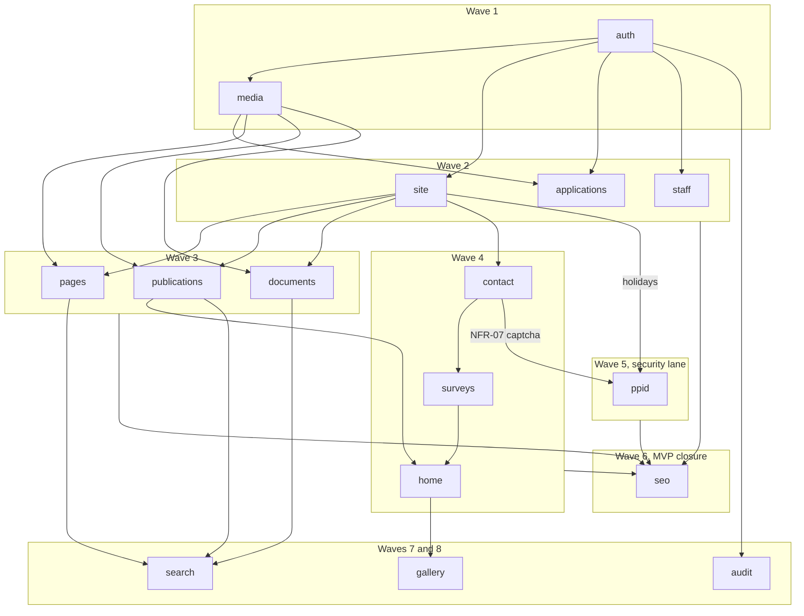

# Module roadmap

Which module is built when, and what blocks it. The loop for one module is in [`team-and-agents.md`](team-and-agents.md#module-loop).

- This file: module boundaries, dependency order, waves and `OQ-nn` gates.
- [`../modules/README.md`](../modules/README.md): per-module spec link and lifecycle status (`not started` | `contract` | `in progress` | `done`).
- [`../prd/traceability.md`](../prd/traceability.md): per-requirement status, issue and test.
- **Single-pass rule.** Module `<module>` owns `docs/modules/<module>.md`, OpenAPI tag `<module>`, `/api/v1/<module>`, `/api/v1/admin/<module>`, `api/internal/server/<module>.go` and `api/db/queries/<module>.sql`. `auth` and `media` come first, so every domain module in Waves 2 to 5 builds its public read and its admin CRUD together in one pass.

## Dependency graph

## Waves

| Wave | Module | FR / NFR ids | Depends on | Why here (unlocks / constraints) |
|---|---|---|---|---|
| 1 (MVP) | `auth` (security lane) | FR-33, NFR-05, NFR-17 | none | Bootstraps `pgxpool` and `dbgen.Queries` on `Server`, `scs` sessions, `argon2id`, login delay, 5 x 9 `Can(user, perm)` RBAC, TOTP (mandatory for Super Admin and PPID Officer) and AES-256-GCM envelope encryption. Unblocks every `/api/v1/admin/*` endpoint. Bootstraps the Page/PageSize OpenAPI params and oapi-codegen/runtime (listUsers, getUser), the KEK keyring and the admin CLI (create admin, TOTP break-glass, key rotation). |
| 1 (MVP) | `media` | FR-38, NFR-06 | `auth` | Reuses the `Page`/`PageSize` params from auth. Magic-byte validation, safe disk storage, thumbnails (5 s or less) and alt-text rules used by all content and PPID uploads. |
| 2 (MVP) | `site` | FR-02, FR-03, FR-35, FR-37, FR-44 | `auth` | Layout shell: 3-level menu, single contact/social settings, WITA `visit_daily` footer counter and the WITA `holidays` table (used by `ppid`). |
| 2 (MVP) | `applications` | FR-28, FR-37 | `auth`, `media` | 16 application cards with admin ordering. Parallel with `site` and `staff`. |
| 2 (MVP) | `staff` | FR-07, FR-37 | `auth` | 241-row directory (search, division filter, sort, pagination) and admin CRUD. |
| 3 (MVP) | `pages` | FR-05, FR-35 | `auth`, `media`, `site` | Static pages (slug, rich text, tables, attachments) and menu binding. Unblocks `seo`. |
| 3 (MVP) | `publications` | FR-10, FR-11, FR-13, FR-34 | `auth`, `media`, `site` | 10 categories, cards, detail with view count, 30-day popular sidebar, draft/scheduled/published CRUD. Unblocks `home` and `seo`. |
| 3 (MVP) | `documents` | FR-15, FR-19, FR-36 | `auth`, `media`, `site` | 71-category catalog, single and 20-file bulk upload, and the `information_type` marker that drives the 5 PPID Public Information pages (FR-19). |
| 4 (MVP) | `contact` | FR-29, NFR-03, NFR-07 | `auth`, `site` | Introduces the shared self-hosted PoW captcha, honeypot and per-IP rate limiter (NFR-07), reused by `surveys` and `ppid`. Contact page and admin inbox. |
| 4 (MVP) | `surveys` | FR-25, FR-26, FR-27, FR-37, NFR-07 | `auth`, `contact` | Public Information survey (17 items), IKM survey (24 items, conditional cost, innovation), live poll percentages per period, admin question/period CRUD and CSV export. |
| 4 (MVP) | `home` | FR-01, FR-37 | `auth`, `media`, `site`, `publications`, `surveys` | Sliders, head-of-agency message, 3 PPID shortcuts, 7 latest publications, survey block, site contact details. |
| 5 (MVP) | `ppid` (security lane) | FR-20, FR-21, FR-22, FR-24, NFR-05, NFR-06, NFR-07, NFR-08, NFR-17 | `auth`, `media`, `site` (holidays), `contact` (NFR-07) | 3 PPID forms, AES-256-GCM for KTP and attachments, AV scan hook, officer queue with 10 + 7 working-day deadlines, TOTP-gated PII access, append-only PII access log (`privileges.sql`). |
| 6 (MVP) | `seo` and MVP gates | FR-41, FR-42, NFR-01, NFR-03, NFR-04, NFR-05, NFR-10, NFR-11, NFR-12, NFR-13 | Waves 2 to 5 | Dynamic `sitemap.xml`, `robots.txt`, Open Graph/canonical check, 301 redirects for the 7 legacy URL patterns (1 hop or less), content migration reconciliation (OQ-01), backup/restore and KEK drill, Lighthouse/axe/ZAP gates. |
| 7 (Phase 2) | `search` | FR-04, FR-43 | `pages`, `publications`, `documents` | Global `pg_trgm` + `unaccent` search grouped by type (p95 1 s or less); friendly 404/500 pages with a search box. |
| 7 (Phase 2) | `audit` | FR-39 | `auth`, Waves 2 to 5 | Append-only admin activity log on content/settings mutations (`app` role denied `UPDATE`/`DELETE` in `privileges.sql`). |
| 7 (Phase 2) | extensions and Should NFRs | FR-06, FR-08, FR-09, FR-12, FR-16, FR-17, FR-18, FR-23, FR-45, NFR-02, NFR-09, NFR-14, NFR-15, NFR-16 | Waves 2 to 5 | Extend existing specs: `publications` tag page (FR-12); `documents` filter (FR-16), hierarchy (FR-17), daily download counter (FR-18); `pages` versioned series (FR-06) and HTML tables (FR-09); `home` hero page (FR-45); `staff` CSV import (FR-08); `ppid` tickets and SMTP (FR-23). |
| 8 (Phase 3) | `gallery` and extensions | FR-14, FR-30, FR-31, FR-32 | `auth`, `media`, `home`, `site` | `gallery` photos/YouTube (FR-14); `home` agenda calendar and sholat widget (FR-30, FR-31); `site` admin visit dashboard (FR-32). |
| Deferred | none | FR-40 | `ppid`, `surveys` | Leadership summary; `Won't` in PRD Section 9, reviewed after release. |

Waves 7 and 8 need the scope decision in OQ-14. Waves inside the MVP may overlap as soon as a module's dependencies are `done`.

## Open question gates

A gate stops only the named work. Everything in the last column proceeds with a configurable or synthetic default; write `depends on OQ-nn` in the spec where a default stands in.

| OQ | Affects | Hard stop at | Proceeds before the answer |
|---|---|---|---|
| OQ-01 | NFR-12 | Wave 6 migration reconciliation | Migration tooling against synthetic fixtures. |
| OQ-02 | FR-20, FR-21, FR-22, FR-24 | `ppid` contract (objection/complaint deadline, routing) | Forms, queue, status model; objection/complaint deadline as a setting. |
| OQ-03 | FR-20, NFR-08 | `ppid` contract (KTP number, file or removed) | KTP as an encrypted value; the contract fixes the type. |
| OQ-04 | NFR-09, NFR-10 | Wave 6 deploy and staging | Local dev stack; no host assumptions in code. |
| OQ-05 | FR-30, FR-31 | Wave 8 `home` extensions | Nothing; Could priority. |
| OQ-06 | FR-09 | Wave 7 `pages` extension | Alt-text field and HTML table support. |
| OQ-07 | FR-06 | Wave 7 `pages` extension | Single-version pages (FR-05). |
| OQ-08 | FR-17 | Wave 7 `documents` extension | Flat 71-category catalog (FR-15, FR-36); categories are data, so regrouping is a data change. |
| OQ-09 | FR-10, FR-14 | Wave 3 `publications` seed list; Wave 8 `gallery` | Categories as data rows; `gallery` not started. |
| OQ-10 | FR-33 | `auth` contract (publish approval step) | Editor publishes directly; an approval step is a later contract change. |
| OQ-11 | FR-23 | Wave 7 `ppid` extension | Ticket numbers without email notification. |
| OQ-12 | FR-22, NFR-06 | `media` and `ppid` allow-list values | Allowed types and max sizes are per-feature configuration. |
| OQ-13 | FR-25, FR-26, FR-27, FR-41 | Wave 6 cutover date | `surveys` and redirects are built; the date only sets the cutover plan. |
| OQ-14 | Section 9, C-5 | Start of Wave 7 | Waves 1 to 6. |
| OQ-15 | NFR-08 | `ppid` contract (retention, data-subject requests) | Store timestamps; no purge job. |
| OQ-16 | NFR-05, NFR-17 | `auth` merge and production keys | Drafts with the PRD defaults (`argon2id`, AES-256-GCM, TLS 1.2+). |
| OQ-17 | NFR-17 | `ppid` go-live and Wave 6 KEK drill | Dev key from environment, test data only. |

## Keeping it current

- Pick the earliest unblocked module from the wave table; check its row in the gate table first.
- The contract PR adds `docs/modules/<module>.md` and sets its status to `contract` in [`../modules/README.md`](../modules/README.md).
- Lane PRs move that status to `in progress`, then `done`, and fill `Status`, `Issue` and `Test` in [`../prd/traceability.md`](../prd/traceability.md).
- A Phase 2 or 3 extension edits the existing module spec in a new contract PR before any lane work.
- A change to module boundaries or waves edits this file in the same PR; `make docs-check` fails if an FR id is missing here.
